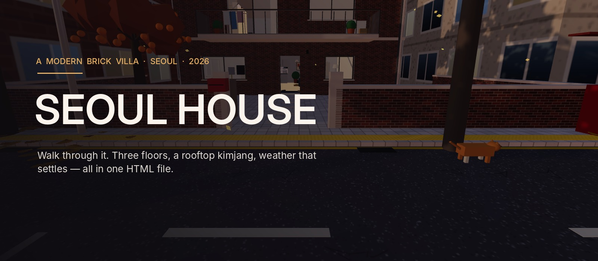
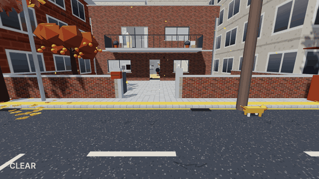
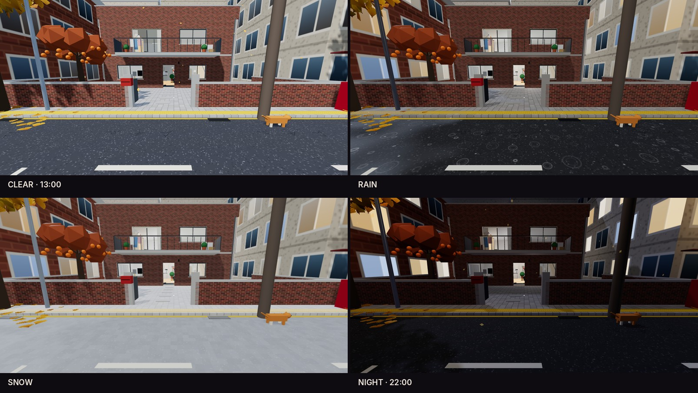
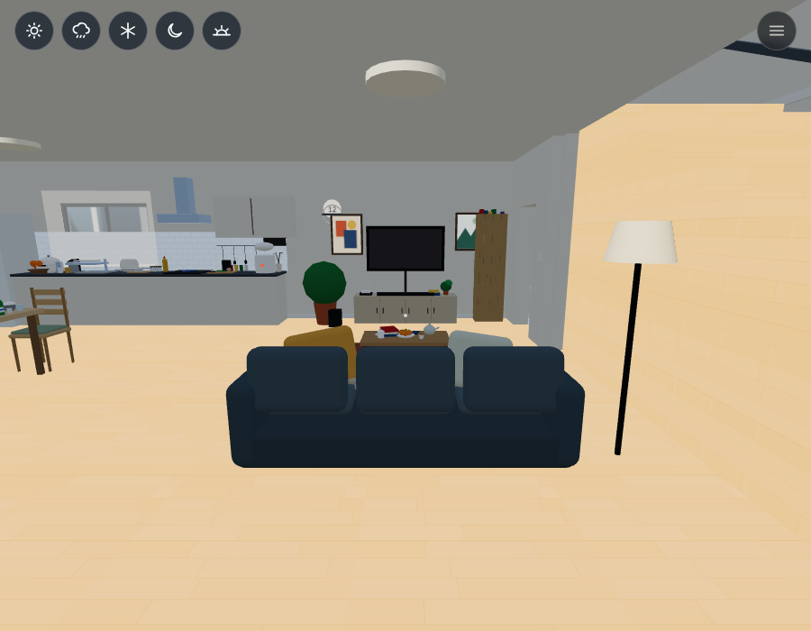
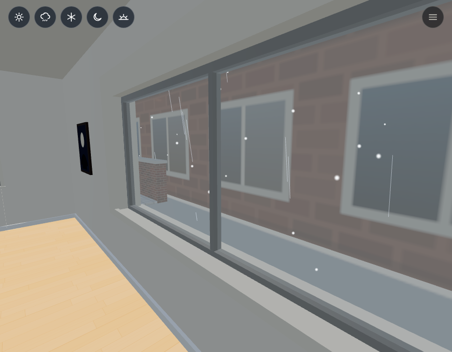
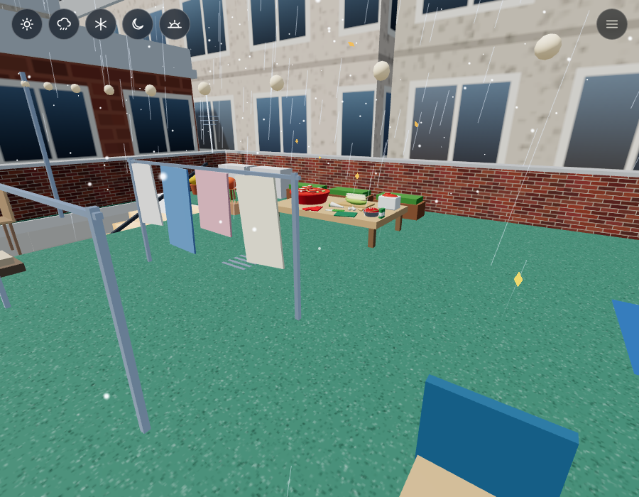
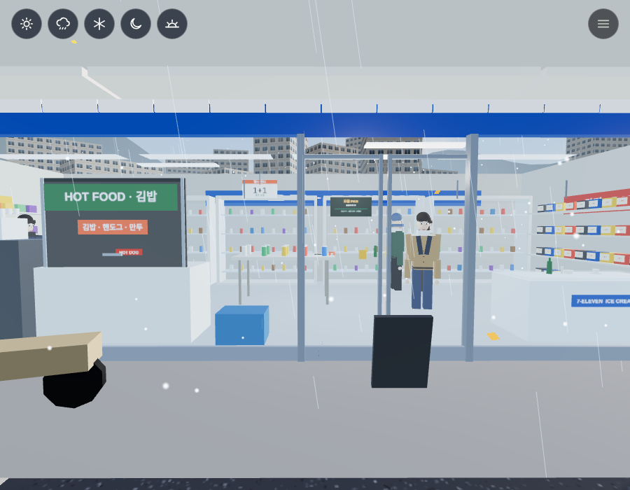
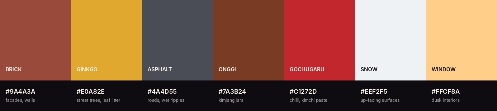

<h1 align="center">SEOUL HOUSE</h1>
<h3 align="center">SEOUL · 2026</h3>

<p align="center"><em>A brick villa on a quiet Seoul street, written to be walked through.</em></p>

<p align="center">
  <a href="./index.html"><strong>▶ OPEN SEOUL HOUSE →</strong></a><br>
  <sub>One file · 760 KB · desktop and phone · no install · WebGL2</sub>
</p>

<p align="center">
  <code>three.js r160</code> &nbsp;·&nbsp; <code>single HTML</code> &nbsp;·&nbsp; <code>0 external requests</code> &nbsp;·&nbsp; <code>EN · 한국어 · 中文 · 日本語</code>
</p>

---

## The weather



Download `index.html` and double-click it. It runs offline, so it works on desktop and phone without a server, a CDN or a single network request.

The loop above cycles the five states the street can be in: **clear → rain → snow → dusk → night**. Press `1` `2` `3` `4` to switch, or use the buttons top-left on a phone.



<sub>Clear, rain, snow and night from the same spot on the street. Rain draws layered ripple rings and splashes on the asphalt; snow settles only on up-facing surfaces.</sub>

<details>
<summary>How the weather behaves</summary>

| State | What changes |
|---|---|
| **Clear** | rain and snow layers are hidden outright, not just faded to zero; leaves drift |
| **Rain** | layered ripple rings and splash flashes on asphalt, puddle tint, wet-surface darkening |
| **Snow** | accumulation only on up-facing surfaces; roads and pavements turn white |
| **Dusk / night** | windows, room lights and street lamps follow the darkness |
| **Indoors** | weather is suppressed inside shops and restored, exactly as chosen, on the way out |

Weather moves on **real elapsed time**, not the capped frame step, so the sky clears in a second or two on a slow phone as well as a fast desktop.

</details>

---

## The house


**SEOUL HOUSE** is a three-storey brick villa behind a low wall, on a street of ginkgo trees, a convenience store, a cafe and a cat that has somewhere to be. It begins with the domestic detail of a Seoul family house — ondol floors, a fridge that is never quite empty, a rooftop where the cabbage is salted in November — and turns it into a place you can walk through.

> The goal is not realism by polygon count. It is **legibility**: kimchi is kimchi, the stove is a stove, and everything sits on something.

---

## The project

| | |
|---|---|
| **Site** | a villa and a street block: convenience store, cafe, stalls, ginkgo avenue |
| **Levels** | 1F living, dining, kitchen, bath · 2F bedroom and desk · 3F rooftop kimjang |
| **Delivery** | one self-contained `index.html`, ~760 KB, three.js inlined and tree-shaken |
| **Assets** | none: geometry, textures, music and voice lines are all generated in code |
| **Source** | ~6,000 lines across ten parts, concatenated into one module scope |
| **Platforms** | current Chrome, Edge, Safari; iOS and Android with touch controls |
| **Languages** | English, 한국어, 中文, 日本語, switched at runtime |
| **Network** | 0 external requests |

---

## The plan

| Ground floor | Upper floors |
|---|---|
|  |  |

The house is a stack of rooms joined by a stair rather than a corridor with doors.

On the **ground floor** the living room faces the street; the **dining table** sits between it and the **kitchen**, and the bathroom is tucked behind. **Upstairs** is the bedroom, with a desk whose monitor shows a Mac-style desktop. The **stair** opens onto the **rooftop**, where the kimjang is laid out.

> The best rooms are not the largest ones. They are the ones that look lived in at a glance.

---

## Why it works

### 1. A fridge that behaves
Contents are placed by a **shelf packer**: it measures each item, fills shelves row by row, and is audited at build time. `window.__fridge.violations` must be empty — every jar stays inside the fridge, on a shelf, with the door able to close.



### 2. Rooftop kimjang
Napa cabbage halves with layered red paste, a brine tub, chilli threads drying on a mat and onggi jars. Readable from across the roof, because each shape is recognisable before it is detailed.



### 3. Weather that settles
Rain, snow and night are controlled by a single state that **always wins**. Choosing *Clear* clears every precipitation layer; shop interiors can only hide the weather, never re-enable it; and the choice you made is restored when you step back outside.

### 4. Shadows stay on
Shadows are what ground the props. Performance work goes through **adaptive resolution** and a manual **Quality** switch, never through disabling `shadowMap`.

### 5. Every prop has a surface
The 2F floor exists only for part of the plan (there is a stair opening), so anything placed there has to be checked. `test/float.mjs` flags every small mesh with nothing under it.

### 6. A street that lives
Pedestrians, a cat, ginkgo leaves, a synthesised ballad playing on the living-room TV, voice lines from neighbours, and shops you can walk into.



---

## Lived-in details

- Dining table with place settings and a stew pot
- TV unit with soundbar, sofa and coffee table
- Kitchen counter with dish rack, cutting board and a ramen pot you can cook
- A bed with a crumpled duvet and uneven pillows
- A desk, a monitor and a lamp
- Bathroom with towels and a stool
- Convenience store, cafe, stalls and a chicken-and-beer order
- Wet roads, snow on rooftops, leaves along the kerb

---

## Palette



| Colour | Where it is used |
|---|---|
| **Brick** | facades, garden walls, the house itself |
| **Ginkgo** | street trees and leaf litter; the one warm accent in the street |
| **Asphalt** | roads, and the surface that rain ripples read on |
| **Onggi** | kimjang jars and storage pots |
| **Gochugaru** | chilli, kimchi paste, the red mailbox |
| **Snow** | up-facing surfaces only |
| **Window light** | dusk interiors, the reason the house looks occupied |

<sub>Swatches are approximate values read from the scene, not a separate design system.</sub>

---

## Controls

| | Desktop | Phone |
|---|---|---|
| Move | `W` `A` `S` `D` | left stick |
| Look | mouse (click to capture) | drag right half |
| Interact | `E` | tap the prompt |
| Weather | `1` clear · `2` rain · `3` snow · `4` night | top-left buttons |
| Room tour, sound, language, quality | menu (top right) | menu (top right) |

Phone: adaptive resolution keeps the frame rate up, and **Quality: high** can be switched on manually when the device can afford it.

---

## Technical notes

```text
src/
  template.html    HTML/CSS shell: HUD, menu, hints, no-WebGL fallback
  p0_i18n.js       EN / KO / ZH / JA strings
  p1_core.js       renderer, helpers (box/cyl/sph/grp/cm), canvas textures, weather-aware materials
  p2_world.js      ground, street, buildings, trees, sky
  p3_house.js      the three floors, stairs, rooms, lights, colliders
  p5_detail.js     kitchen, living, small details, people, talk interactions
  p7_life.js       fridge shelf packer, ramen, soju, lived-in clutter
  p8_props.js      table setting, stove, TV, sofa, toilet, Mac desktop, bed, kimchi
  p4_systems.js    main loop, weather, day/night, audio, interactions, collisions
  p6_tour.js       room tour, menu, quality control, audio suspend on tab hide
  p9_ds.js         street shops, music, voice, basket, faces, optional dusk
test/              headless-Chromium audits: fridge containment, floating objects, screenshots
docs/img/          README images
```

Design choices worth knowing:

- **One module scope.** `build.sh` concatenates the parts, so shared helpers are plain top-level bindings. `const` helpers are not hoisted — `p8` sits after `p7` for that reason.
- **Helper convention.** `box / cyl / sph` take `y` as the **bottom** of the object, `el` (ellipsoid) takes `y` as the **centre**, and a rotated cylinder needs an explicit centre. Most "floating object" bugs come from mixing these up.
- **Weather layers own their visibility.** Rain, snow and leaves are tagged `userData.wx`; other systems (shop interiors) may hide them but never switch them back on.
- **Time-based animation.** Weather and day/night use real elapsed time, so behaviour is frame-rate independent.

---

## Build

```bash
./build_standalone.sh      # installs three@0.160.0 + esbuild locally, writes ./index.html
```

Requires Node 18+ and Python 3. The output is a single file with three.js inlined.

`./build.sh` alone only concatenates the sources into `all.js` and syntax-checks them; the result is not runnable without the bundle step, so always test `index.html`.

## Tests

```bash
npm i --no-save playwright
node test/run_audit2.mjs index.html          # fridge containment audit
node test/float.mjs index.html               # floating-object report
node test/shots.mjs index.html out '[{"n":"dining","x":-3.2,"z":-4.4,"y":0.1,"yaw":0,"pitch":-0.25}]'
```

## Scaling notes

The scene is built from many small meshes. That is fine today, but per-object draw calls are the first thing to hurt on low-end phones as props are added. Static batching of non-moving props is the planned next step.

## Roadmap

- Static batching for non-moving props
- Reflective puddles, snow footprints
- Contact shadows and more Korean street furniture
- A hosted live demo

---

## Credits

Built on [three.js](https://threejs.org/) (MIT). All geometry, textures, music and voice lines are generated in code; there are no third-party assets, brands or real people in the scene.
