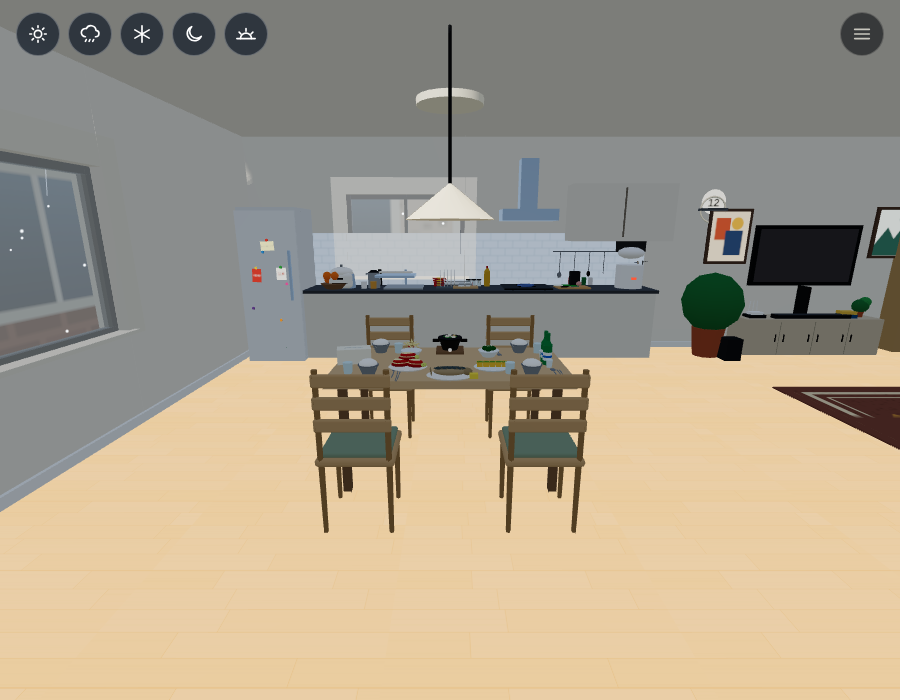
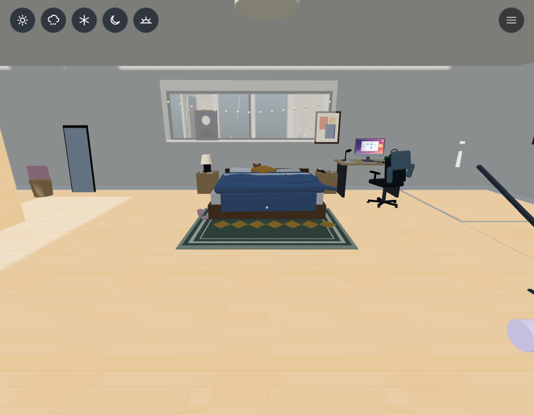
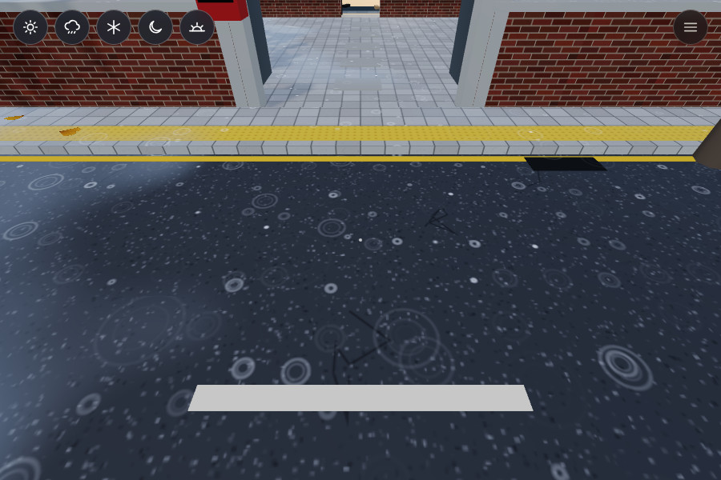

<div align="center">

# Seoul House

**A modern Seoul brick villa you can walk through — in a single HTML file.**

Three floors, a rooftop kimjang, a convenience-store street, live weather, and a fridge where every jar stays inside the fridge.

[**▶ Open `index.html`**](./index.html) · [Controls](#controls) · [How it works](#how-it-works) · [Build](#build)

   



</div>

---

## What this is

An explorable, game-like Seoul house built with **procedural geometry and procedural textures only**: no models, no image files, no fonts, no CDN. Download one file, double-click, and walk around on desktop or phone.

The goal is not realism by polygon count. It is **legibility**: every object should be recognisable at a glance (kimchi is kimchi, the stove is a stove), sit on something, and never clip through its container.

## Highlights

| | |
|---|---|
| **Lived-in interiors** | Dining table with place settings and a stew pot, TV unit with soundbar, sofa and coffee table, kitchen counter with dish rack and cutting board, bathroom, a bed with a crumpled duvet and uneven pillows, a desk whose monitor shows a Mac-style desktop. |
| **A fridge that behaves** | Contents are placed by a shelf packer that measures each item, fills shelves row by row, and is audited at build time: `window.__fridge.violations` must be empty. |
| **Rooftop kimjang** | Napa cabbage halves with red-paste layers, a brine tub, chilli threads drying on a mat, onggi jars. Readable from across the roof. |
| **Weather that settles** | Clear, rain, snow, night and dusk. Wet roads get layered ripples and splash flashes, snow accumulates on up-facing surfaces only, and the sky clears in a second or two even on a slow phone. |
| **A street that lives** | Convenience store, cafe and stalls, pedestrians, a cat, ginkgo leaves, synthesized ballad playing on the living-room TV, voice lines from neighbours. |
| **Phone and desktop** | Touch sticks and a single menu on mobile, WASD + mouse on desktop. Adaptive resolution with a manual **Quality: high** switch. |
| **Four languages** | English, 한국어, 中文, 日本語 at runtime. |

## Gallery

<table>
<tr>
<td><br><sub>Living room</sub></td>
<td><br><sub>Fridge, door open</sub></td>
</tr>
<tr>
<td><br><sub>2F bedroom and desk</sub></td>
<td><br><sub>3F rooftop kimjang</sub></td>
</tr>
<tr>
<td><br><sub>Street and convenience store</sub></td>
<td><br><sub>Rain ripples on wet asphalt</sub></td>
</tr>
</table>

## Controls

| | Desktop | Phone |
|---|---|---|
| Move | `W` `A` `S` `D` | left stick |
| Look | mouse (click to capture) | drag right half |
| Interact | `E` | tap the prompt |
| Weather | `1` clear · `2` rain · `3` snow · `4` night | top-left buttons |
| Room tour, sound, language, quality | menu (top right) | menu (top right) |

## How it works

```
src/
  template.html    HTML/CSS shell: HUD, menu, hints, no-WebGL fallback
  p1_core.js       renderer, helpers (box/cyl/sph/grp/cm), canvas textures, weather-aware materials
  p0_i18n.js       EN / KO / ZH / JA strings
  p2_world.js      ground, street, buildings, trees, sky
  p3_house.js      the three floors, stairs, rooms, lights, colliders
  p5_detail.js     kitchen, living, small details, people, talk interactions
  p7_life.js       fridge shelf packer, ramen, soju, lived-in clutter
  p8_props.js      recognisable props: table setting, stove, TV, sofa, toilet, Mac desktop, bed, kimchi
  p4_systems.js    main loop, weather, day/night, audio, interactions, collisions
  p6_tour.js       room tour, menu, quality control, audio suspend on tab hide
  p9_ds.js         street shops, music, voice, basket, faces, optional dusk
```

Design choices worth knowing:

- **One module scope.** `build.sh` concatenates the parts, so shared helpers are plain top-level bindings. `const` helpers are not hoisted: `p8` sits after `p7` for that reason.
- **Helper convention.** `box / cyl / sph` take `y` as the **bottom** of the object, `el` (ellipsoid) takes `y` as the **centre**, and a rotated cylinder needs an explicit centre. Most "floating object" bugs come from mixing these up.
- **Surfaces exist before props do.** The 2F floor only exists for part of the plan (there is a stair opening), so anything placed there must be checked: `test/float.mjs` flags every small mesh with nothing under it.
- **Shadows stay on.** They are what ground the props. Performance work goes through the adaptive resolution and the **Quality** switch, never through disabling `shadowMap`.
- **Time-based animation.** Weather and day/night use real elapsed time, not the capped frame step, so behaviour is frame-rate independent.

## Build

```bash
./build_standalone.sh      # installs three@0.160.0 + esbuild locally, writes ./index.html
```

Needs Node 18+ and Python 3. The output is a single file with three.js inlined and tree-shaken.

`./build.sh` alone only concatenates the sources into `all.js` and syntax-checks them; the dev output is not runnable without the bundle step, so always test `index.html`.

## Tests

The scripts in `test/` drive headless Chromium through Playwright:

```bash
npm i --no-save playwright
node test/run_audit2.mjs index.html          # fridge containment audit
node test/float.mjs index.html               # floating-object report
node test/shots.mjs index.html out '[{"n":"dining","x":-3.2,"z":-4.4,"y":0.1,"yaw":0,"pitch":-0.25}]'
```

## Scaling notes

The scene is built from many small meshes. Fine today, but per-object draw calls are the first thing to hurt on low-end phones as props are added. Static batching of non-moving props is the planned next step.

## Roadmap

- Static batching for non-moving props
- Reflective puddles (screen-space or planar), snow footprints
- Contact shadows and more Korean street furniture

## Credits

Built on [three.js](https://threejs.org/) (MIT). All geometry, textures, music and voice lines are generated in code; there are no third-party assets, brands or real people in the scene.
